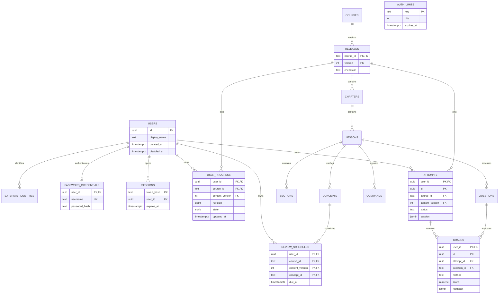

# Quan hệ database

Các entity tương ứng bảng trong schema ở README. Quan hệ content dùng khóa ghép `course_id, content_version, id`; quan hệ grade/attempt còn có `user_id` để ngăn gắn điểm vào phiên của tài khoản khác.

`app_meta.schema_migrations` độc lập với nghiệp vụ, ghi tên migration, SHA-256 và thời gian áp dụng. Sáu bảng nghiệp vụ riêng và ba bảng xác thực dùng RLS; runtime chỉ gọi các hàm xác thực giới hạn, không sửa trực tiếp identity hoặc content.

Tiến độ v1 lưu dưới dạng aggregate để bảo toàn bản sao cũ. Bảng attempts/grades/review_schedules đã có ràng buộc nhưng chưa có API/UI ghi riêng. Đã có auth/session local; xem docs/AUTHENTICATION.md. Credential database và SQL context không thay thế danh tính người dùng.
